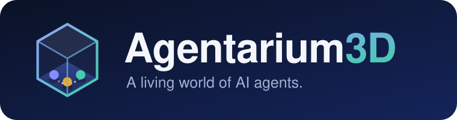
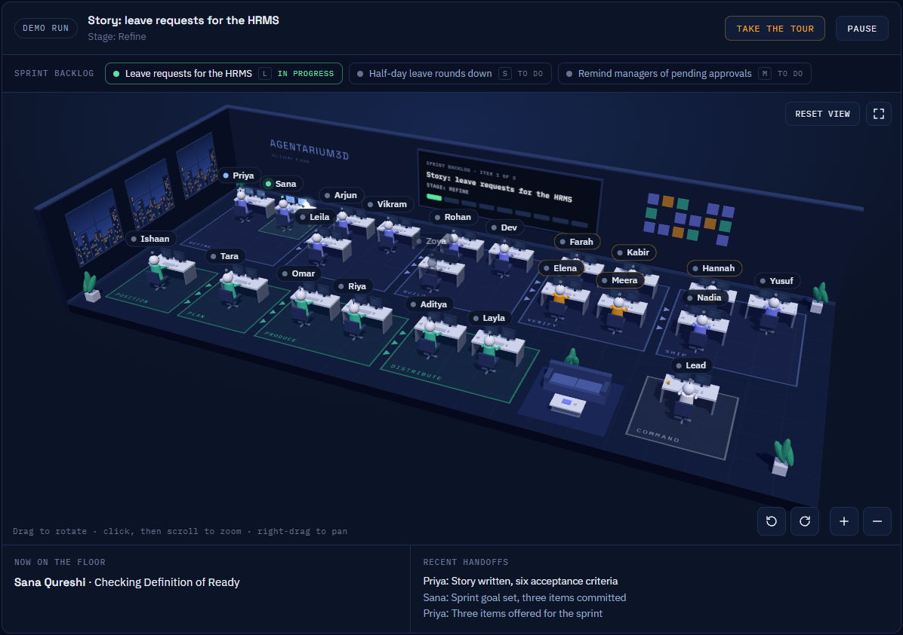

<p align="center">
  
</p>

<p align="center">
  <b>A living world of AI agents.</b> Step inside and watch them work.
</p>

<p align="center">
  <a href="https://agentarium3d.jawed-iitk.workers.dev/">Live demo</a> ·
  <a href="DOCS.md">Documentation</a> ·
  <a href="#run-it">Run it locally</a> ·
  <a href="#use-it-on-your-own-page">Embed it</a>
</p>

<p align="center">
  
</p>

Agentarium3D is a 3D office floor where every desk is an AI agent with a role, and a piece of work
moves from desk to desk through a delivery pipeline. It runs in the browser, is built with three.js,
has no build step, and everything in it is modelled in code.

The figures are AI agents, not employees. One desk, labelled "Lead", is the human. The floor plays
a scripted example of a sprint and says so on screen ("Demo run").

## Why

AI agents are doing more and more real work, but nobody can see them do it. Agentarium3D makes an
agent-run company visible: every desk is a specialist, every handoff happens in front of you, and
every gate that stops a mistake turns red where you can see it.

- **Visible by default.** Anything an agent does is something you can see on the floor.
- **Specialists, not a single genius.** Each agent has one role and one desk.
- **A human decides.** The lead's desk stays on the floor; the gates and the person are part of the picture.

## What you can do with it

- **Watch a sprint.** Work items move through Refine, Design, Build, Verify and Ship. When a
  gate role blocks a release, its station turns red and a barrier drops.
- **Take the tour.** A guided camera tour follows the whole sprint with captions.
- **Look around.** Drag to rotate, scroll to zoom, click a desk to pin that agent's card.
- **Switch looks.** A dark office with robot-style figures, or a daylight office with people-style
  figures wearing status badges.
- **Switch company type.** Besides the IT floor there are two concept layouts (manufacturing and
  media), labelled as concepts on screen.
- **Play the opening sequence.** `index.html` starts in a dark room at a monitor, then dives into
  the floor.
- **Show live status** from a JSON file instead of the scripted run.

## Run it

It must be served over http; browsers do not load script modules from `file://`.

- Windows: double-click `preview-floor3d.bat` (needs Python).
- Anywhere: `python -m http.server 8765` in this folder, then open `http://127.0.0.1:8765/`.

| Page | What it shows |
| --- | --- |
| `index.html` | Opening sequence, then the floor (same as `floor3d-intro.html`) |
| `floor3d.html` | Night look |
| `floor3d-day.html` | Daylight look, with the dark/day switch |

`index.html` and `floor3d-intro.html` start the guided tour by themselves after the opening
sequence; add `?tour=0` to open them without it, or press "Exit tour" at any time. On the other two
pages add `?tour=1` to start the tour by itself. `?wall=Your%20Name` puts a name on the back wall.

## Use it on your own page

```html
<link rel="stylesheet" href="floor3d/floor3d.css">
<div id="agentarium3d"></div>
<script type="module">
  import { mount } from "./floor3d/main.js";
  mount(document.getElementById("agentarium3d"), { look: "day", wallName: "YOUR COMPANY" });
</script>
```

Every option, the live-status file format, the layouts and the behaviour notes are in
[DOCS.md](DOCS.md). To change the agents, stations or the scripted run, edit `floor3d/data.js`
and `floor3d/layouts.js`.

## Good to know

- The demo pages load three font families from Google Fonts. Remove that `<link>` to keep the
  page free of outside requests; it falls back to system fonts.
- If WebGL is not available, a flat drawing of the same floor is shown instead.
- The agent names, the work items and the concept layouts are invented examples.
- The falling code in the opening sequence is drawn from plain letters and symbols. It is a
  look-alike of a familiar film style, not a copy of any film's characters or footage.

## Project files

| Path | What it is |
| --- | --- |
| `index.html`, `floor3d*.html` | The demo pages |
| `floor3d/` | The code: scene, runner, layouts, data, styles, and the vendored three.js |
| `DOCS.md` | Every option, live status, layouts, behaviour notes |
| `assets/` | Logo files and the social preview image |
| `screenshots/` | The picture above |

## Licence

MIT, see [LICENSE](LICENSE). The photo in `floor3d/assets/controller.webp` shows the author and is not
covered by that licence; replace it if you reuse the opening sequence. three.js r187 is included under its own MIT licence
(`floor3d/vendor/three-0.187.0/LICENSE`).
